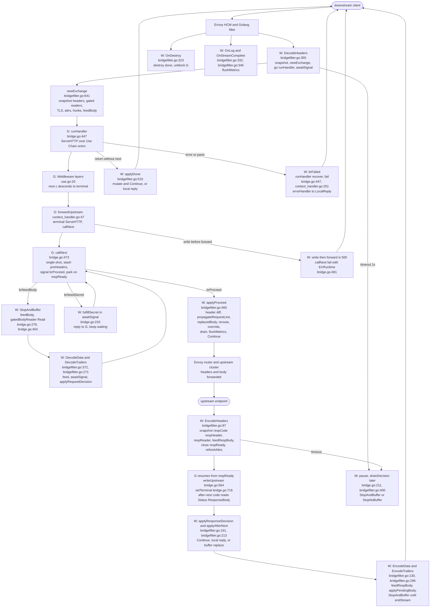

# Architecture: Life of a Request

This document traces one HTTP request through Envoy, the gonvoy bridge, user handler code, upstream, and back. It names the exact types and functions that run on each step, and which thread runs them.

Two threads matter for every request:

* `G`: the handler goroutine started by `bridgeExchange.runHandler` in `bridge.go:447`. It runs `Handler`, `Middleware`, and `Context` code. It touches Go memory only, plus logging. It never calls Envoy C APIs directly.
* `W`: an Envoy callback thread running `bridgeFilter` methods in `bridgefilter.go:12`. All Envoy C calls happen here: header maps, buffer instances, route cache, secrets, stream info, metrics sinks.

`G` and `W` meet through one per-request `bridgeExchange` in `bridge.go:48` and one signal channel `sigCh` with signals `brSignal` in `bridge.go:16`. `G` writes outcome state then signals. `W` waits in `awaitSignal` in `bridge.go:211`, applies the decision, and returns an Envoy status (`api.Continue`, `api.StopAndBuffer`, `api.StopNoBuffer`, `api.LocalReply`).

## Diagram: full request and response path

The boxes name the function that runs. `W` is the Envoy callback thread, `G` is the handler goroutine.

Read the diagram with the phase list below. Each numbered section maps to one row of boxes.

## Components

* Envoy HTTP connection manager, Golang HTTP filter, router filter, upstream cluster. Envoy calls `DecodeHeaders`, `DecodeData`, `DecodeTrailers`, `EncodeHeaders`, `EncodeData`, `EncodeTrailers`, `OnDestroy`, `OnLog`, `OnStreamComplete` on the filter.
* `bridgeFilter` in `bridgefilter.go:16`: the `api.StreamFilter` implementation. It owns a `*context` for Envoy I/O (`ctx`) and one `httpHandler` (`h`). It owns the per-request `exchange`.
* `bridgeExchange` in `bridge.go:48`: snapshots (`reqSnapshot`, `origHost`, `origMethod`, `origPath`), outcome atomics (`nextCalled`, `proceedUpstream`, `gDone` in `bridge.go:82`), writers (`w`, `nextWriter`), body queues (`bodyChunks`, `respChunks`), rendezvous (`respReady`, `sigCh`, `done`), side intents (reroute, refresh, override, drain, metrics, attrs).
* `recordingWriter` in `bridge.go:626`: the `ResponseWriter` the handler sees. It records `header`, `status`, `body`, `wroteHeader`, `explicit`. `setTerminal` in `bridge.go:672` installs the upstream response without setting user-write flags, so the bridge can tell pass-through from an explicit answer.
* `handlerContext` in `context_handler.go:19`: the `Context` implementation. Fields are `w ResponseWriter`, `r *http.Request`, `ex *bridgeExchange`. Every method is nil-safe outside the bridge.
* `Handler` in `handler.go:22`: `func(Context) error`. `ServeHTTP` in `handler.go:26` builds the `Context` view and routes errors to `fail`.
* `Middleware` in `use.go:20`: `func(next Handler) Handler`. `Use` in `use.go:29` composes layers around an internal terminal. `Chain` in `use.go:54` composes layers around a caller-supplied final. The terminal calls `forwardUpstream` in `context_handler.go:47`, which calls `terminal{}.ServeHTTP` in `bridge.go:768`, which calls `callNext` in `bridge.go:473`.

## 1. Registration

`envoy.Handle(name, h, opts...)` registers `h` with `NewHandlerChainFactory` in `bridgefilter.go:32`. The factory checks for nil with `util.IsNil`, parses `*internalConfig`, builds a `*context` with `newBridgeContext`, and returns `newBridgeFilter` in `bridgefilter.go:57` with `errorHandler` set to `defaultErrorHandler` and `sendReply` set to `defaultSendReply`.

No request state exists here. Route config, body access flags, metrics prefix, reload behavior, and plugin config are parsed once and stored on the filter-wide `context`.

## 2. DecodeHeaders: snapshot, start G, first decision

Entry: `DecodeHeaders` in `bridgefilter.go:355`.

1. `W` sets `c.pcb` to decoder callbacks, then calls `newExchange` in `bridgefilter.go:641`:
   * `LoadRequestHeaders` loads the live Envoy request headers into `c.httpReq`.
   * `snapshotRequestHeaders` in `bridgefilter.go:735` copies headers into `ex.reqSnapshot` for later diffing.
   * `r` becomes the live request. `r.Body` is replaced with `gatedBodyReader` in `bridge.go:338` (enabled when request read or write access is on). `ex.gatedBody` points at it. `ex.respReader` is created as `gatedRespReader` in `bridge.go:345` (enabled when response read or write access is on).
   * `origHost`, `origMethod`, `origPath` are snapshotted. `reqHeaderMap` keeps the live Envoy map for later mutation. Stream info and TLS are snapshotted once in `snapshotTLS` in `bridge.go:585`. Secret lookup, hooks, config, and exchange pointers are attached to `r` with `withBridgeConfig`, `withBridgeHooks`, `withBridgeExchange` in `bridge.go:726`. Attributes are snapshotted with `refreshAttrs` in `bridgefilter.go:611`. `feedBody(nil, endStream)` primes the body queue.
2. `W` starts `G` with `go ex.runHandler()` in `bridgefilter.go:361`. `runHandler` in `bridge.go:447` calls `ex.handler.ServeHTTP(ex.w, ex.req)`. For a `Handler`, that builds a `handlerContext` and runs the `Use`/`Chain` onion: outermost `Middleware` first, `next(c)` descends, innermost reaches the terminal.
3. `W` blocks in `awaitSignal` in `bridge.go:211`. The wait has a 1 second timeout. A timeout returns `(0, false)`, and the caller pauses (`StopAndBuffer` on header paths, `StopNoBuffer` on data paths). The next callback picks up the late signal with `drainDecision` in `bridgefilter.go:400`.
4. `G` produces one of:
   * `brNeedBody`: handler blocked reading `r.Body`. `signal` in `bridge.go:182` sends a lossy hint. `W` returns `StopAndBuffer`.
   * `brNeedSecret`: handler called `Secret`. `awaitSignal` fulfills it inline with `fulfillSecret` in `bridge.go:233` (calls `secretLookup`, replies on `secretRequest.reply`), then keeps waiting for the terminal signal. `G` blocks in `requestSecret` in `bridge.go:248` until the reply or `done`.
   * `brProceed`: handler called the innermost `next`, which ran `forwardUpstream` in `context_handler.go:47`, then `terminal{}.ServeHTTP` in `bridge.go:768`, then `callNext` in `bridge.go:473`. Details in section 4.
   * `brDone`: handler returned. `W` runs `applyRequestDecision` in `bridgefilter.go:418`.
   * `brFailed`: handler returned an error or panicked. `runHandler` stores `failErr` and signals. `W` runs `errorHandler` (default maps to status codes and a local reply).
5. `applyRequestDecision` flushes metrics (`flushMetrics` in `bridgefilter.go:589`), applies drain (`applyDrain` in `bridgefilter.go:579`), then branches on the signal.

## 3. Request body and trailers

`DecodeData` in `bridgefilter.go:372`:

* If `proceedUpstream` is already true, the request is streaming upstream. `streamRequestBody` in `bridgefilter.go:711` forwards bytes, swapping in `replacedBody` at end of stream when present. No handler wakeup happens on this path.
* If `G` already finished (`gDone`), `W` drains any left-behind terminal signal with `drainDecision` and applies it, else returns `api.Continue`.
* Otherwise `W` appends bytes with `feedBody` in `bridge.go:276` (wakes `bodyWake` on progress through `pingBody` in `bridge.go:324`), then waits in `awaitSignal` and applies the decision.

`gatedBodyReader.Read` in `bridge.go:439` is what handler code blocks on when it calls `io.ReadAll(c.RequestBody())` or `c.Bind(v)`:

* With buffered chunks and `enabled`, it returns bytes.
* At end of stream it returns `io.EOF`.
* When disabled it returns `ErrOperationNotPermitted` immediately.
* Otherwise it signals `brNeedBody` (so a waiting `W` pauses with `StopAndBuffer`) and parks on `bodyWake` or `done` (client abort maps to `ErrClientClosedRequest`).

`DecodeTrailers` in `bridgefilter.go:271` feeds EOF (`feedBody(nil, true)`) and applies the decision the same way.

Body replacement rule: the handler assigns `c.Request().Body` to a new reader before forwarding. `callNext` reads it fully with `io.ReadAll` into `ex.replacedBody` (small buffered payloads only, not streams). `applyProceed` swaps it into the Envoy buffer at end of stream, or injects it with `AddData` on headers-only requests. Without write permission this path returns 502.

### Header-only guarantee: no body buffering

A filter that touches only headers, host, method, path, query, or attributes never triggers body buffering on either side. Concretely, it never calls `c.RequestBody()` in `context_handler.go:187`, `c.Bind(v)` in `context_handler.go:165`, `c.ResponseBody()` in `context_handler.go:199`, and never assigns `c.Request().Body` or writes a response body with `c.Write()` in `context_handler.go:157`.

Request path:

* No `brNeedBody` is emitted, so `W` never takes the buffering branch for this request. `gatedBodyReader.Read` in `bridge.go:439` is the only place that signals `brNeedBody`, and it is never entered. When body access is disabled it would return `ErrOperationNotPermitted` immediately, also without signaling.
* At `DecodeHeaders` time, `G` returns `brProceed` or `brDone` right away. `W` applies `applyProceed` in `bridgefilter.go:460` or `applyDone` in `bridgefilter.go:515` and returns `api.Continue`. Nothing is held for a body decision.
* Later `DecodeData` calls in `bridgefilter.go:372` take a fast path. After forwarding (`proceedUpstream` true), `streamRequestBody` in `bridgefilter.go:711` streams each chunk with `api.Continue` and wakes no handler. After a direct return (`gDone` true), `W` drains any late signal with `drainDecision` in `bridgefilter.go:400` or returns `api.Continue`. The `feedBody` queue in `bridge.go:276` only grows in the remaining branch, where `G` is still blocked waiting for body bytes. A header-only `G` is already gone, so `ex.bodyChunks` stays empty and no `bodyWake` wait happens.
* Enabling `ReadRequestBody` or `WriteRequestBody` alone does not buffer. It only arms the gated reader. Buffering starts on the first `Read`, when `W` must answer `StopAndBuffer` to hold the current bytes while `G` drains them.

Response path:

* `c.Response().Header` writes before forwarding only touch `w.Header()`. `callNext` stashes them into `preHeaders` with `cloneHeader` in `bridge.go:551` and `writeUpstream` in `bridge.go:564` applies them under the upstream headers: keys the upstream sets keep upstream values, the rest fill in. No body bytes are retained for this.
* Upstream body buffering is gated by `bufferResponseBody` in `bridgefilter.go:160` and by actually reading after `next` returns. Without response read or write access, `gatedRespReader.Read` in `bridge.go:353` fails fast and `EncodeHeaders` in `bridgefilter.go:87` plus `EncodeData` in `bridgefilter.go:130` stream through with `applyHeaderSets` in `bridgefilter.go:259` and `api.Continue`. With access enabled but no read, `feedRespBody` in `bridge.go:299` still runs per callback, yet nothing blocks on `respWake` and `applyPendingBody` in `bridgefilter.go:167` finds no stashed body to replace.
* Trailers follow the same rule. `DecodeTrailers` in `bridgefilter.go:271` and `EncodeTrailers` in `bridgefilter.go:296` only feed EOF and apply the pending decision. A header-only chain is already done, so both return `api.Continue`.

Practical check: if the handler imports neither `io` for `c.RequestBody()` nor `c.Bind`, assigns no `c.Request().Body`, and never calls `c.ResponseBody()` or `c.Write()`, the Go side keeps no request or response bytes. Envoy keeps only the chunk it is currently passing through.

## 4. Forwarding upstream: the parked handoff

This is the only path that waits for the upstream response. It starts when the innermost `next(c)` reaches the terminal built by `Use`:

`next(c)` -> terminal `Handler` in `use.go:36` -> type assert `interface{ forwardUpstream() error }` -> `forwardUpstream` in `context_handler.go:81` -> `terminal{}.ServeHTTP` in `bridge.go:810` -> `callNext` in `bridge.go:508`.

`callNext` steps:

1. Single-shot guard: `nextCalled.Swap(true)`. A second call is a no-op.
2. Set `proceedUpstream` true.
3. Write-then-forward check: if `ex.w.explicit` or `len(ex.w.body) > 0`, this is a competing answer. Call `fail` with `ErrRuntime` wrapped error. The bridge later answers 500 instead of picking a winner.
4. Early-response-body check: if `earlyRespBody` is set (a pre-next response body read), fail the same way. Reading the response before it exists is the same class of bug as answering before proceeding.
5. Read a replacement request body when `r.Body` is not the owned `gatedBodyReader`. Store it in `ex.replacedBody`.
6. Save `nextWriter = w`. Stash pre-forward response header writes from `w.Header()` into `preHeaders` with `cloneHeader` in `bridge.go:551`, then clear `w.Header()` so upstream headers start clean. Pre-forward headers fill in under the upstream response later: keys the upstream sets keep upstream values.
7. Signal `brProceed` (blocking until `W` receives or the stream dies), then park `G` on `respReady` or `done`.
8. When `W` feeds the upstream response (section 5), it closes `respReady`. `G` resumes and runs `writeUpstream` in `bridge.go:564`: if `w` implements `terminalWriter` (the `recordingWriter` does), install status and merged headers with `setTerminal` in `bridge.go:716` without setting user-write flags. Otherwise write status and headers directly. After-code in the `Middleware` now runs: `c.Status()`, `c.ResponseBody()`, header mutation, body replacement. Merged means upstream values win on key conflicts; staged pre-forward headers survive only for keys upstream did not set.

Key point: a plain `Handler` that returns `nil` without calling `next` never parks. `applyDone` in `bridgefilter.go:515` still applies request mutations and returns `api.Continue`. Parking happens only inside `Use` when some layer calls `next(c)`.

## 5. Upstream response arrives: EncodeHeaders

Entry: `EncodeHeaders` in `bridgefilter.go:87`.

1. If `ex == nil`, return `api.Continue`.
2. Set encoder callbacks, load response headers into the filter-wide `context`, read `respCode` and snapshot `respHeader` with `snapshotRequestHeaders`, keep `liveRespHeader` for in-place mutation. Build `respReader` based on response read/write access. When response write access is on, drop stale `Content-Length` with `shouldOmitContentLengthOnResponse`. Feed end-of-headers into the response queue with `feedRespBody(nil, endStream)`, then close `respReady` once with `respReadyOnce`. This unblocks a parked `G`.
3. Snapshot response attributes and flush metrics (`refreshAttrs` with `response=true`, `flushMetrics`).
4. Three cases:
   * Handler already finished without forwarding (`gDone` true, `nextCalled` false): drain any late signal. If none, apply locally written headers with `applyHeaderSets` in `bridgefilter.go:259` and return `api.Continue`. The response streams through unmodified.
   * Handler parked (`nextCalled` true) or still running: wait in `awaitSignal`, then run `applyResponseDecision` in `bridgefilter.go:191`.
   * No signal (timeout or destroy): return `StopAndBuffer` and converge on the next callback through `drainDecision`.

`applyResponseDecision`:

* `brNeedBody`: return `StopAndBuffer`.
* `brFailed`: run `errorHandler` with `ex.failErr`.
* `brProceed`: return `api.Continue`. The request already went upstream in `applyProceed`. The response now streams.
* `brDone`: run `applyAfterNext` in `bridgefilter.go:213` (handler returned after forwarding).

`applyAfterNext` rules:

* No writes (`!wroteHeader` and empty body): apply header diff to the live response map. When `nextWriter` exists, diff `respHeader` to `nextWriter.Header()` with `applyHeaderDiff` in `bridgefilter.go:747`. Else apply recorded headers with `applyHeaderSets`. Return `api.Continue`.
* Explicit status (`w.explicit`) or no buffered body to replace into: send a full local reply with `sendReply` (`defaultSendReply` in `bridgefilter.go:68`, status defaults to 200, headers from `ex.w`). When no explicit status exists, reuse `respCode`.
* Body-only write with a buffered upstream body and write permission: replace at end of stream with `buffer.Set`, else `StopAndBuffer` until end.
* Body-only write without write permission: `errorHandler` with `ErrOperationNotPermitted` (502 path).

## 6. Response body and trailers

`EncodeData` in `bridgefilter.go:130`:

* If `G` already finished, drain a late signal or run `applyPendingBody` in `bridgefilter.go:167` (stashed body-only replacement applied at end of stream; without write permission it errors; without a complete buffered body it pauses).
* Else, when response buffering is on (`bufferResponseBody` in `bridgefilter.go:160`), feed bytes with `feedRespBody` in `bridge.go:299` (wakes `respWake`), wait in `awaitSignal`, and apply the response decision.

`gatedRespReader.Read` in `bridge.go:353` mirrors the request reader: buffered chunks first, `io.EOF` at end, `ErrOperationNotPermitted` when disabled, else signal `brNeedBody` and park on `respWake` or `done`.

`ResponseBody(r)` in `bridge.go:395` returns `ex.respReader` only after forwarding and only when response access is enabled. Calling it before forwarding fails.

`EncodeTrailers` in `bridgefilter.go:296` feeds end-of-response and applies the decision the same way as `EncodeData`.

## 7. Local reply and pass-through paths

`applyDone` in `bridgefilter.go:515`:

* No recorded status and no body: apply request mutations (`applyRequestMutations` in `bridgefilter.go:536`) and return `api.Continue`. This is the cheap pass-through path. Mutations to headers, `Host`, `Method`, `Path` still land through `applyHeaderDiff` and `propagateRequestLine` in `bridgefilter.go:440`.
* Any recorded response: send a local reply with `sendReply`. Status 0 defaults to 200 in `defaultSendReply`. Headers come from `ex.w`. `SendResponse` carries `LocalReplyWithHTTPHeaders`.

`applyRequestMutations` steps:

* Diff `reqSnapshot` to `ex.req.Header` onto the live map (`header` if present, else `reqHeaderMap`).
* When request write access is on, omit stale request `Content-Length` for chunked replacement.
* Propagate `Host`, `Method`, `Path` through pseudo-header setters (plain header diff cannot do this).
* Apply upstream override (`SetUpstreamOverrideHost`; invalid host maps to 500).
* Apply route reload: immediate `RefreshRouteCache` once when `refreshRoute` is set, else lazy `ReloadRoute` when `reroute` is set or `autoReloadRoute` plus `requestMutated` in `bridgefilter.go:488`.

`applyProceed` in `bridgefilter.go:460` is the forwarding variant: it runs the same mutations, then handles `replacedBody` (swap at end of stream or inject with `AddData`), then returns `api.Continue`.

## 8. Errors, panics, and teardown

* Handler error: `Handler.ServeHTTP` in `handler.go:26` catches the returned error and calls `fail` in `context_handler.go:251` (no-op when `ex` is nil or a failure is already recorded). `W` sees `brFailed` and runs `errorHandler`.
* Handler panic: `runHandler` recovers, stores `failErr` (`handler panic: ...` when not an `error`), signals `brFailed`. Same `errorHandler` path.
* Write-then-forward: `callNext` fails with `ErrRuntime`. No winner is picked. Logs and 500 come from the error handler.
* Body misuse: reads without read access and writes without write access return `ErrOperationNotPermitted` (502 path). Response-body write without a buffered body becomes a full reply or pauses per `applyAfterNext`.
* Secret lookup: `G` stores `secretRequest` and signals `brNeedSecret`. `W` fulfills it inside `awaitSignal` with `fulfillSecret` and keeps waiting. This never terminates the wait by itself.
* Metrics: handler code queues `MetricOp` through `emitMetric`. `W` flushes in order with `flushMetrics` on every decision point. Outside the bridge the queue drops.
* Attributes: `refreshAttrs` snapshots `request.host`, `request.method`, `request.path`, `xds.cluster_name`, `xds.route_name` on request, plus `response.code`, `response.code_details`, `response.flags` on response. `Attr` reads the snapshot under `attrMu`.
* Drain: `Drain` sets `ex.drain`. `applyDrain` applies once through `streamInfo.DrainConnectionUponCompletion` when present.
* Destroy and logs: `OnDestroy` in `bridgefilter.go:323` closes `done` once through `destroy` in `bridge.go:266`, unblocking every parked `G` select. `f.exchange` is cleared. `OnLog` in `bridgefilter.go:332` and `OnStreamComplete` in `bridgefilter.go:346` flush metrics at access-log and stream-complete time.

## 9. Ordering summary

Request path order on `W`: `DecodeHeaders` -> `DecodeData`* -> `DecodeTrailers` (if present) -> router forwards upstream.

Response path order on `W`: `EncodeHeaders` -> `EncodeData`* -> `EncodeTrailers` (if present).

Handler order on `G`: outermost `Middleware` before-`next` code in `Use` order, innermost terminal (`forwardUpstream`), then after-`next` code in reverse order. `Chain` follows the same onion with a caller-supplied final instead of the internal terminal.

Timeout behavior: `awaitSignal` waits 1 second. A timeout pauses the stream and converges on the next callback through `drainDecision`, which ignores stale `brNeedBody` signals because a finished `G` will never act on more body.

## 10. Known limitation: gRPC

gRPC flows through the same HTTP connection manager, so requests reach this bridge, but the bridge models plain HTTP bodies and does not model gRPC semantics. See the user-facing scope in [user-guide/grpc-scope.md](user-guide/grpc-scope.md) for what belongs here.

* Replacements are small buffered payloads, not streams. `callNext` in `bridge.go:473` reads a replacement fully into `ex.replacedBody`.
* Body reads block `G` (`gatedBodyReader.Read` in `bridge.go:404`, `gatedRespReader.Read` in `bridge.go:353`) while `awaitSignal` in `bridge.go:211` bounds each wait at 1 second and converges through `drainDecision`. That fits one buffered body, not a long-lived RPC.
* `Bind` in `context_handler.go:138` accepts JSON only. Protobuf frames, including the 5-byte header, need manual decoding from `Body` in `context_handler.go:160`.
* Trailers carry `grpc-status` and `grpc-message`, but `Context` has no trailer API. `DecodeTrailers` in `bridgefilter.go:271` and `EncodeTrailers` in `bridgefilter.go:296` exist on the bridge, yet filter code cannot read or set trailers through `Context`.
* `ResponseBody` in `bridge.go:395` is available only after forwarding and only with response access enabled. Local gRPC-aware rejects use `LocalReplyWithGRPCStatus` in `reply_options.go:66`; direct `Context` replies stay HTTP shaped.
